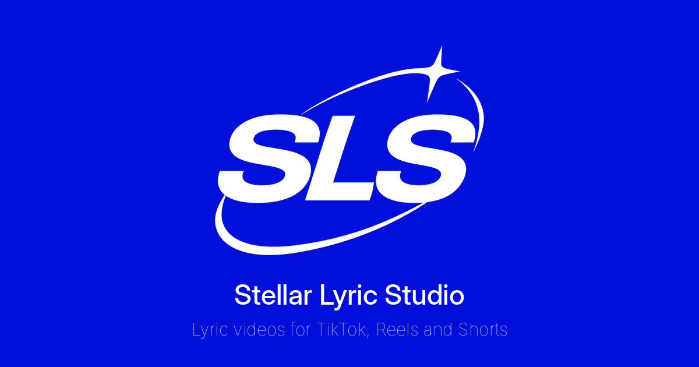
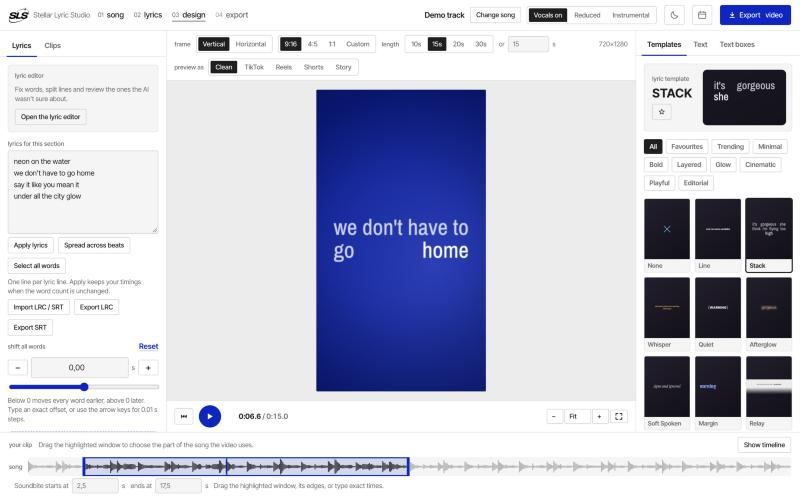
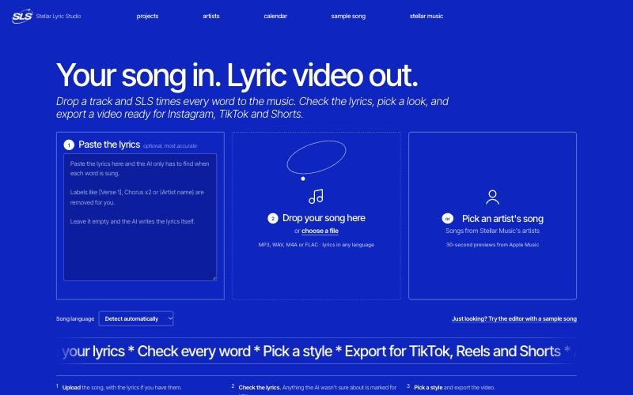
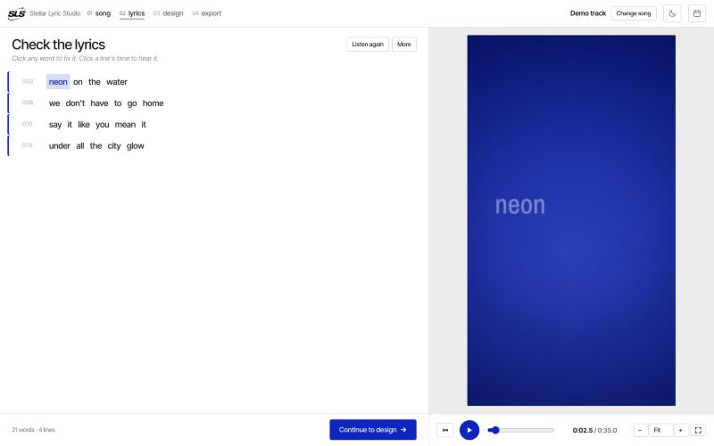
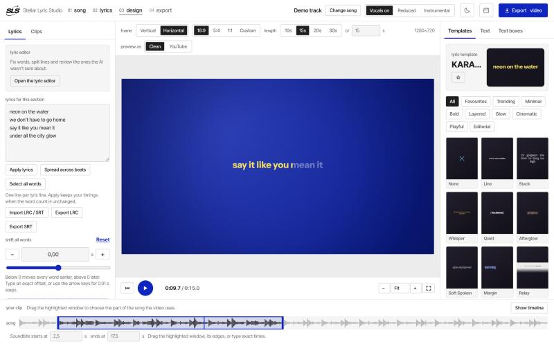
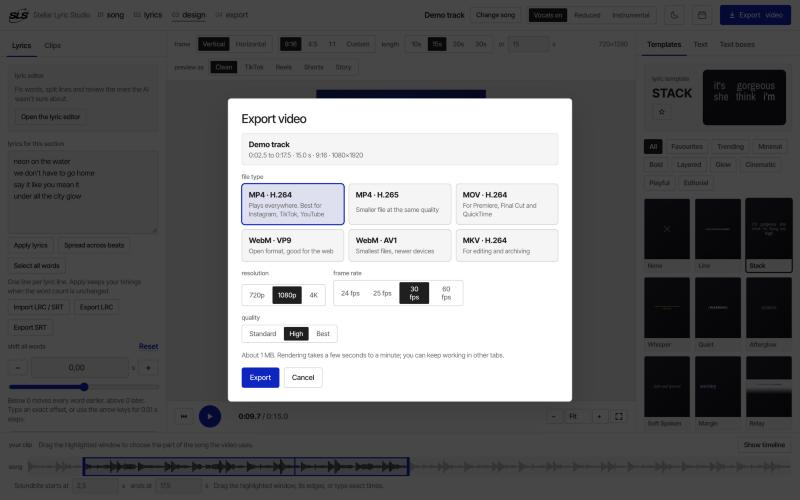
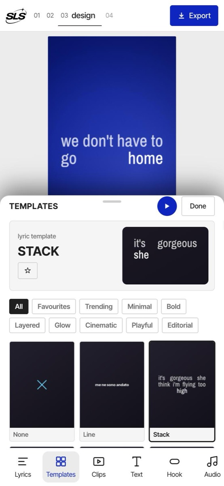

<p align="center">
  
</p>

<p align="center">
  <b>Your song in. Lyric video out.</b><br>
  Drop a track, the lyrics are written and timed to every word for you, pick a look and export a video
  ready for TikTok, Reels and Shorts.<br>
  Made by <a href="https://stellarmusic.dk">Stellar Music</a> · <a href="https://lyrics.stellarmusic.dk">lyrics.stellarmusic.dk</a>
</p>

<p align="center">
  
</p>

## What it does

- **Lyrics written and timed for you.** Paste the lyrics (or let the AI write them) and every word is timed to the
  music. About 100 languages.
- **Check every word.** Click a word to fix it; words the AI wasn't sure about are marked.
- **Dozens of lyric templates.** Minimal, bold, layered, glow, cinematic, playful, editorial and trending looks,
  with your own text boxes and hooks on top.
- **Any frame.** Vertical or horizontal, 9:16, 4:5, 1:1, 16:9, 5:4, or your own size in pixels.
- **Backgrounds.** Free stock videos and photos picked to match how the song feels (no AI-made ones), AI
  backgrounds written from the lyrics, and your own moodboards (drag the images into order).
- **Best parts and TikTok sounds.** Finds the parts of a song that work best as a soundbite, and finds where a
  TikTok sound sits in the song by listening to it.
- **Made to fit the song.** The studio reads how the song feels and suggests a lyric style, search ideas, a soft
  colour over the footage and cuts that follow its energy. All optional.
- **Export in the browser.** MP4, MOV, WebM or MKV, 720p to 4K, rendered frame by frame on your own computer.
  Extra versions in one go: other frame shapes, or the song's other best parts.
- **Post and plan.** Post to YouTube, Instagram and TikTok accounts in one go, schedule posts for later and see
  them in the calendar, with the versions of each song compared by views and likes.
- **Works on phones.** The whole studio works on a phone, and it can be added to the home screen as an app.

<table>
  <tr>
    <td width="50%"><br><sub>Start: paste the lyrics, drop the song</sub></td>
    <td width="50%"><br><sub>Check the lyrics, word by word</sub></td>
  </tr>
  <tr>
    <td><br><sub>Vertical, horizontal or your own size</sub></td>
    <td><br><sub>Export MP4, MOV, WebM or MKV, up to 4K</sub></td>
  </tr>
</table>

<p align="center">
  <br>
  <sub>The same studio on a phone</sub>
</p>

---

## For developers

### How it is put together

| Part | Where | What it does |
| --- | --- | --- |
| The app | `public/` | Plain HTML, CSS and JavaScript. No build step. |
| The editor engine | `public/js/studio.js`, `public/css/studio.css` | Preview, frame sizes, styles, clips, timeline. |
| The guided flow | `public/js/app.js`, `public/css/sls.css` | Splash, start screen and the four steps. The Stellar Music design is in `public/css/brand.css`. |
| Logins | `public/js/auth.js`, `src/login.js`, `src/auth.js` | Username plus team code, accounts in Supabase. |
| Lyric AI | `public/js/transcribe.js` | Cuts the song into pieces, has them transcribed twice, compares the passes and marks unsure words. |
| Lyric review | `public/js/lyrics.js` | Click a word to fix it, keep or correct the unsure ones. |
| Lyric templates | `public/js/styles-extra.js`, `styles-more.js`, `styles-trend.js` | The lyric looks beyond the built-in ones. |
| Best parts and TikTok sounds | `public/js/soundbites.js`, `soundmatch.js`, `ttsound.js`, `src/tiktok-sound.js` | Finds strong soundbites; matches a TikTok sound to its place in the song (saved per song in `song_sounds`). |
| Song vibe | `public/js/vibe.js`, `src/vibe.js` | Reads how the song feels (lyrics plus tempo, loudness and brightness measured from the audio) and steers the video and photo searches with it. Also keeps AI-made pictures and videos out. |
| Footage | `public/js/footage.js`, `src/media.js` | Stock video (Pixabay, Pexels), also picked for the song and AI backgrounds (Higgsfield). |
| Photos and moodboards | `public/js/photos.js`, `src/photos.js` | The image grabber (free photos and Pinterest, ranked against the lyrics) and moodboards kept in the browser. |
| Safe zones | `public/js/safezones.js` | Shows where TikTok, Reels, Shorts, Stories and YouTube put their buttons. Never exported. |
| Export | `public/js/export.js`, `public/vendor/` | Renders frame by frame and encodes in the browser (mediabunny, MPL-2.0). |
| Projects | `public/js/projects.js` | Every song is a project: autosaved, and synced to the account. |
| Templates | `public/js/templates.js` | Reusable looks, starter looks built in. |
| Posting and scheduling | `public/js/publish.js`, `calendar.js`, `src/publish.js`, `src/schedule.js` | Linked YouTube, Instagram and TikTok accounts; posting now or later; the calendar. |
| Backend | `src/worker.js`, `api/index.js` | One router. Runs on Vercel through `api/index.js` (server settings are read from its `NAMES` list), or as a Cloudflare Worker. |

The speech model is Whisper large v3 turbo on Cloudflare Workers AI: about 100 languages, a time for every word.

### Run it on your computer

```bash
npm install
npm run dev
```

Then open http://localhost:8787. Local settings go in `.dev.vars` (copy `.dev.vars.example`). Without
`CF_ACCOUNT_ID` and `CF_API_TOKEN` there, the lyric AI answers with a canned sample.

### Releases

The live site runs on Vercel: every push to `main` deploys. Installed phone apps update themselves when
`public/version.txt` changes, so every release bumps it **and** the `sls-build` meta tag in `public/index.html`
to the same new timestamp (`yyyymmddhhmm`, UTC), in the same commit.

### Server settings

On Vercel, under Settings > Environment Variables (on Cloudflare: `npx wrangler secret put <NAME> -c wrangler.jsonc`).

| Key | What for |
| --- | --- |
| `SUPABASE_URL`, `SUPABASE_KEY` | Accounts (the publishable key is a public value) |
| `SUPABASE_SECRET_KEY` | The scheduler: reads everyone's due posts |
| `TEAM_CODE` | The code people log in with |
| `TOKEN_KEY` | Seals linked accounts and logins. Changing it logs everyone out of their accounts |
| `CF_ACCOUNT_ID`, `CF_API_TOKEN` | The lyric AI (token with "Workers AI" access) |
| `PIXABAY_KEY`, `PEXELS_KEY` | Stock video and free photos |
| `CHARTMETRIC_REFRESH_TOKEN` | Trending TikTok sounds in the calendar (a Chartmetric API account) |
| `SERPAPI_KEY` | Pinterest in the image grabber (about 3 searches per grab) |
| `HF_KEY_ID`, `HF_KEY_SECRET` | AI background clips (Higgsfield) |
| `GOOGLE_CLIENT_ID`, `GOOGLE_CLIENT_SECRET` | Posting to YouTube |
| `INSTAGRAM_APP_ID`, `INSTAGRAM_APP_SECRET` | Posting to Instagram |
| `TIKTOK_CLIENT_KEY`, `TIKTOK_CLIENT_SECRET` | Posting to TikTok |
| `TIKTOK_AUDITED` | Set to `1` once TikTok has approved the app: unlocks public direct posts |
| `BLOB_READ_WRITE_TOKEN` | Vercel Blob: exported videos are uploaded there for posting (Vercel caps requests at 4.5 MB) |
| `RESEND_API_KEY`, `NOTIFY_EMAIL` | Optional emails: new accounts, scheduled posts that went live or failed |
| `SLS_PASSCODE` | Only without Supabase: one shared passcode instead of accounts |

Each platform's login sends people back to `https://<your site>/api/oauth/youtube` (or `instagram`, `tiktok`).
Pinterest images belong to whoever posted them: fine for drafts and moodboards, but the free photos are the safe
choice for videos you publish.

### Accounts

Everyone logs in with a username and the team code; there are no passwords. A new username gets an account
straight away, and "Remember me" keeps a device logged in. Anyone with the team code can open any account by
typing its username, so keep the code inside the team.

Projects and linked accounts belong to the account and follow it to any device. Songs and footage stay in the
browser they were added in.

- Run `supabase/schema.sql` once in the Supabase SQL editor (tables, row-level security, the team-code check), and
  turn off "Confirm email" under Authentication > Sign In / Providers.
- Usernames are stored as `<username>@users.lyrics.stellarmusic.dk`; no mail is sent there.
- Changing the team code: set `TEAM_CODE` and redeploy, then run
  `insert into private.settings (key, value) values ('team_code', 'NEW-CODE') on conflict (key) do update set value = excluded.value;`
  Everyone keeps their account and just types the new code.

### Scheduled posts and the calendar

Posts live in the `posts` table. Every 5 minutes Supabase's pg_cron calls `/api/cron` (`src/schedule.js`), which
posts what's due, checks on posts still processing, and now and then reads back views, likes and comments. The
posts part of `supabase/schema.sql` turns on pg_cron and pg_net and sets the job. A scheduled video waits in
Vercel Blob until it's posted, then it's deleted.

### Notes

- Songs are sent to the backend in 30 second pieces for transcription only. Nothing is stored.
- `brand/` holds the original logo, `samples/` an example LRC and SRT, `docs/screenshots/` the pictures above.
